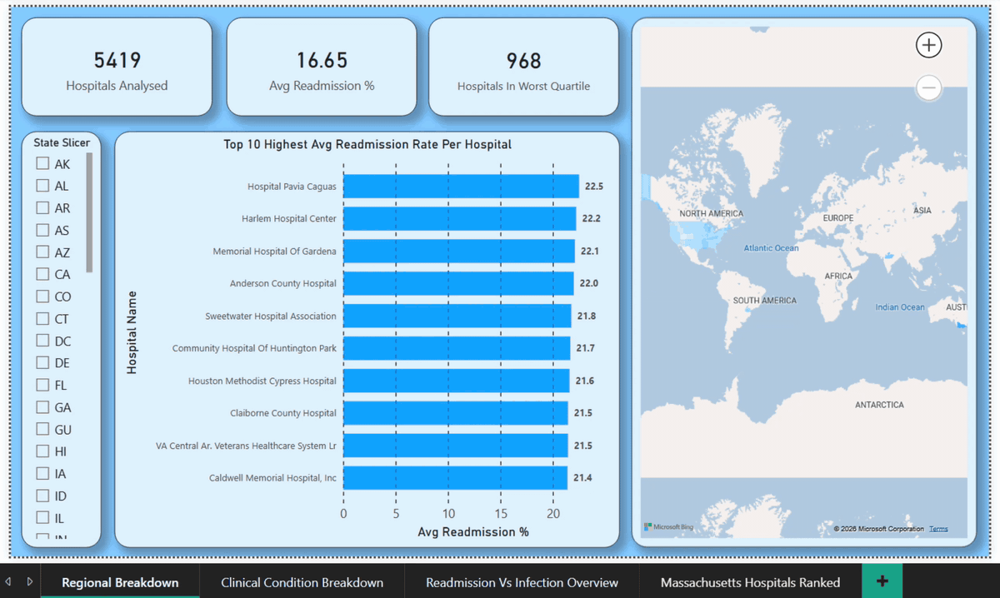
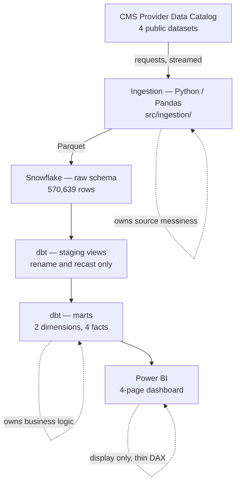
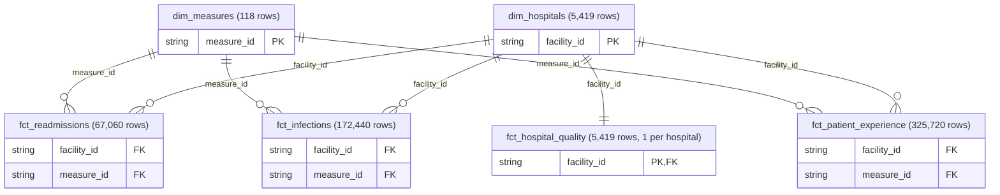

# HRRP Pipeline

## What it is

An end-to-end analytics pipeline that organizes CMS (Centers for Medicare & Medicaid Services) hospital quality data. Its primary purpose is to answer the questions: **which hospitals are readmitting patients more often than their peers, and what else is true about those hospitals?** This project was built to organize and explore what hospitals navigate with the HRRP (Hospital Readmissions Reduction Program) and [new changes around HRRP that are starting in 2027 through 2030](https://www.cms.gov/newsroom/fact-sheets/fy-2027-hospital-inpatient-prospective-payment-system-long-term-care-hospital-prospective-payment).



**Python / Pandas → Snowflake → dbt → Power BI**

570,639 rows · 10 dbt models · 34 dbt tests · 26 unit tests

<br>

---

<br>

## The problem

The CMS **HRRP** reduces Medicare reimbursement for hospitals whose 30-day readmission rates exceed expectations. This makes readmission performance one of the most financially consequential metrics in US healthcare.

CMS publishes the underlying data openly. The datasets are large and have a lot of data quality issues that need resolving before an executive-level stakeholder would view them. See [Findings and decisions from working with the CMS data](#findings-and-decisions-from-working-with-the-cms-data).

<br>

---

<br>

## Architecture



**Each layer owns one class of problem**

| Layer | Owns | Function |
|---|---|---|
| Python | Ingestion, using the `requests` library | Resolves each dataset's download URL from its stable CMS ID at runtime, which keeps the pipeline refreshable across quarterly releases |
| Pandas | CSV parsing, null markers, type casting, column naming | Cleans each file into a consistently named Parquet, so a CMS format change touches one module |
| Snowflake | Storage, single source of truth | Holds the raw tables and the dbt models in one warehouse, so every tool queries the same numbers |
| dbt | Business logic, in tested, version-controlled SQL | Defines each metric once, so "Worst Quartile" has a single definition that can be reviewed |
| Power BI | Visualization only | Displays the dbt marts, so the dashboard can be replaced without losing the logic or the underlying data |

<br>

---

<br>

### The data model

The project looks at four CMS datasets: [Hospital General Information](https://data.cms.gov/provider-data/dataset/xubh-q36u), [Unplanned Hospital Visits](https://data.cms.gov/provider-data/dataset/632h-zaca), [Healthcare Associated Infections](https://data.cms.gov/provider-data/dataset/77hc-ibv8) and [Patient survey (HCAHPS)](https://data.cms.gov/provider-data/dataset/dgck-syfz). Each table relates on facility_id as a key, and three of them relate on measure_id as another key. These shared keys connect the fact tables to two dimension tables, one for hospitals and one for measures. Because several fact tables share those same two dimensions, the data model is a galaxy schema. 



<br>

---

<br>

## Findings and decisions from working with the CMS data

The design of the pipeline itself was the most straightforward part of this project. The difficult half was discovering that **CMS packs several different types of units into a single value column in every one of these files**, keyed by `measure_id` and no obvious annotation denoting the changes. This created an immediate and apparent data quality issue. Each of the four problems below produced a plausible number that resulted with no meaning behind it.

- **Three units in one column.** The readmissions file holds percentages, excess days in acute care, and outpatient visit rates together. A dbt test asserting a 0 to 100 bound failed on 3,857 rows, so I scoped the test to the percentage measures rather than loosening the bound.
- **Statistics mistaken for ratios.** The infections file holds six statistics for each infection type, and only one of them is a ratio. Averaging all of them together gave an infection ratio of roughly 2,700, where a standardized infection ratio is centered on 1.0.
- **A comparison column that was empty.** CMS's `national_comparison` is NULL on every readmission row, so my first `benchmark_tier` was scoring outpatient measures under a readmission label. The tier is now a quartile of each hospital's mean readmission rate, and it claims rank and nothing more.
- **Title-casing that could add errors.** Some the hospital names had `LA`, which can be Los Angeles or Louisiana. Another example, `MT` can be Mount or Montana. 

None of these threw an error, so digging into the data was required in addition to corrections from those findings. The column that ties them together is `measure_unit` in `dim_measures`. It records the unit of every measure in one place, so the dashboard filters on a column instead of reimplementing the rule in DAX.

<br>

---

<br>

## Data quality framework

The project runs 34 dbt tests, and they cover all five of the test types dbt supports.

| Type | Count | Example |
|---|---|---|
| `not_null` | 18 | every foreign key on every fact table |
| `relationships` | 7 | fact to dimension, never the reverse |
| `unique` | 4 | `facility_id` in `dim_hospitals` |
| `accepted_values` | 2 | `benchmark_tier`, `measure_domain` |
| custom bounds | 3 | readmission rate 0 to 100, star rating 1 to 5, infection ratio at or above 0 |

**The direction of a relationship test matters here.** The hospital dimension
holds 5,419 hospitals and the fact tables hold 4,790, because 629 hospitals
report no measures at all. A test written from the dimension to the facts would
fail on those 629 rows, even though every one of them is correct.

Alongside the dbt tests, 26 pytest unit tests cover the ingestion layer. They run
against a committed fixture rather than the 157 MB of source CSVs, so the suite
needs no network connection and no warehouse.

<br>

---

<br>

## Dashboard

The dashboard is four pages, saved as `docs/HRRP Dashboard.pbix`, and it can be
downloaded and opened in Power BI Desktop. I built it in **Import mode** so that
it keeps working in the event things break.

| Page | Shows |
|---|---|
| Regional Breakdown | KPI cards, a choropleth or shaded map, the top ten hospitals by rate, and a state slicer |
| Clinical Condition Breakdown | Readmission rates by condition, with hospital level detail |
| Readmission Vs Infection Overview | A scatter colored by quartile, with an ownership slicer |
| Massachusetts Hospitals Ranked | The Massachusetts distribution against the national average |

One finding from the last page is that Massachusetts does not skew elite on
readmissions, given it's prevalence with medical school concentration and being a biopharma hub. A third of its hospitals sit in the second
quartile against 18 percent nationally, and it carries roughly half the national
share in the worst quartile.

<br>

---

<br>

## Stack

| | Version |
|---|---|
| Python | 3.13.15 |
| pandas | 2.3.3 |
| dbt-core / dbt-snowflake | 1.12.4 / 1.12.0 |
| snowflake-connector-python | 4.7.3 |
| pyarrow | 25.0.1 |
| pytest | 9.1.1 |

`pandas` is pinned below 3.0 because the Snowflake connector's `[pandas]` extra
requires a version under 3.0.0. 

<br>

---

<br>

## Running it

```bash
python3.13 -m venv .venv
source .venv/bin/activate
python -m pip install -r requirements.txt

cp .env.example .env          # fill in Snowflake credentials
```

Create the warehouse objects by running `sql/01_setup.sql` and then
`sql/02_raw_tables.sql` in a Snowflake worksheet.

```bash
python main.py                      # download, clean, write Parquet
python main.py --skip-download      # reuse data/raw/ while developing
python -m pytest tests/             # 26 unit tests, no network

cd dbt_project
set -a; source ../.env; set +a
DBT_PROFILES_DIR=$PWD dbt build     # 10 models, 34 tests
DBT_PROFILES_DIR=$PWD dbt docs generate
```

The claims this README makes can be checked against the repository and the live
warehouse in one command.

```bash
python -m scripts.verify_claims
```

The file `sql/02_raw_tables.sql` is **generated** from the Parquet schemas by
`scripts/generate_raw_ddl.py`, so the warehouse table definitions cannot drift
away from what the transformer actually produces.

<br>

---

<br>

## What I would do differently

- **Airflow or Dagster.** Every run is manual right now. Orchestration would be a logical next step to improve this project.
- **Two more CMS datasets.** Complications and Deaths covers mortality, and
  Timely and Effective Care covers process measures. Adding both would extend the model to include mortality and process-of-care.
- **The HRRP program dataset itself.** CMS publishes
  [Hospital Readmissions Reduction Program](https://data.cms.gov/provider-data/dataset/9n3s-kdb3)
  as its own dataset, and it carries the excess readmission ratio along with the
  predicted and expected rates for each of the six HRRP conditions. That is the
  data an actual penalty read requires, and it is the one thing this project
  cannot currently do.
- **Continuous integration.** `dbt test` and `pytest` should run on every commit
  through GitHub Actions.
- **Incremental dbt models.** A full refresh is reasonable at 570,000 rows, but it
  would not be at 50 million. 
- **A significance test on the tier.** The four files this project ingests
  publish neither a national comparison nor a confidence interval for the
  readmission measures, so the tier claims rank rather than statistical
  significance. The HRRP dataset above is what would change that.

<br>

---

<br>

## Data source

Everything here comes from the
[CMS Provider Data Catalog](https://data.cms.gov/provider-data/topics/hospitals)
and is public domain. The four datasets are resolved by their stable dataset ID
at runtime, because each download URL carries a content hash that changes with
every quarterly release. Hardcoding a URL would work today and return a 404 in
three months.

The files in this build were downloaded on 21 October 2026. CMS last modified
Unplanned Hospital Visits on 10 September 2026, and the other three datasets on
22 July 2026.
